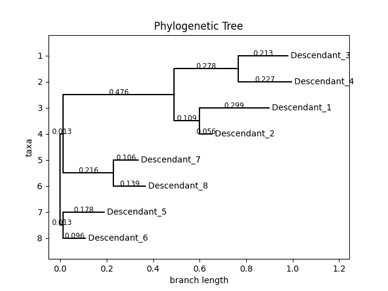
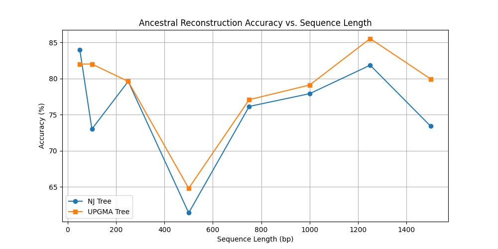

# Phylogenetic inference and ancestral reconstruction

Distance-based tree estimation and probabilistic ancestral-state analysis of aligned nucleotide sequences.

## Algorithms

- **Jukes–Cantor** sequence-divergence estimates and pairwise distance matrices.
- **Neighbor Joining** and **UPGMA** tree construction.
- **Felsenstein-style pruning** to evaluate tree likelihoods.
- Ancestral sequence reconstruction and comparison across simulated or supplied inputs.

**Implementation:** [`ex3.py`](ex3.py)  
**Experiment drivers:** [`run_part2.py`](run_part2.py), [`run_part3.py`](run_part3.py)

## Results

| Inferred Neighbor Joining tree | Reconstruction accuracy |
|:---:|:---:|
|  |  |

[Likelihood comparison](results/log_likelihood_comparison.png) · [Additional NJ tree](results/NJ_tree_100.png)

## Running

```bash
python ex3.py --help
```

The scripts require compatible aligned nucleotide FASTA sequences and may reference filenames from the original experiments. Those datasets are not bundled.

**Skills:** graph/tree algorithms, evolutionary sequence models, likelihood inference, scientific evaluation and visualization.
