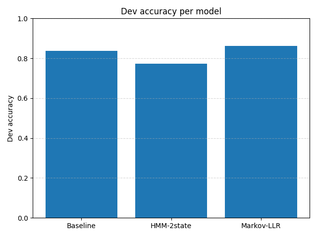
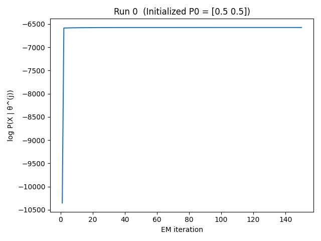

# Computational Biology Algorithms

Algorithmic implementations for signal segmentation, probabilistic sequence analysis, CpG-island detection, and phylogenetic inference. The repository combines dynamic programming, hidden Markov models, expectation-maximization, evolutionary distance models, and tree reconstruction, with evaluation plots from the corresponding experiments.

**Stack:** Python · NumPy · Matplotlib · Biopython  
**Areas:** Dynamic programming, probabilistic modeling, sequence analysis, phylogenetics

## Algorithms

| Project | Core methods | Source |
|---|---|---|
| [Signal segmentation](01-dynamic-programming-segmentation/) | Prefix sums, segment costs, dynamic programming, runtime analysis | [`segment.py`](01-dynamic-programming-segmentation/segment.py), [`time_analysis.py`](01-dynamic-programming-segmentation/time_analysis.py) |
| [HMM / EM and CpG annotation](02-em-and-cpg/) | EM training, hidden-state inference, CpG labeling, model comparison | [`q_em.py`](02-em-and-cpg/coin-hmm/q_em.py), [`annotate_cpg.py`](02-em-and-cpg/cpg-annotation/annotate_cpg.py) |
| [Phylogenetic inference](03-phylogenetic-inference/) | Jukes–Cantor distances, NJ, UPGMA, Felsenstein pruning, ancestral reconstruction | [`ex3.py`](03-phylogenetic-inference/ex3.py) |

## Experimental results

| Phylogenetic reconstruction accuracy | CpG annotation model comparison |
|:---:|:---:|
|  |  |

| Neighbor Joining tree | EM convergence |
|:---:|:---:|
|  |  |

These figures record specific experiment configurations. Details of the datasets, assumptions, and experimental procedures are described within each project.

## Technical approach

**Segmentation.** Segment costs are calculated efficiently using cumulative sums and squared sums. Dynamic programming selects a piecewise-constant partition subject to a penalty and a maximum segment length.

**Sequence modeling.** A two-state hidden Markov model is fitted through expectation-maximization, while CpG sequence annotation compares probabilistic sequence-labeling approaches and reports model performance.

**Phylogenetics.** Pairwise sequence distances feed Neighbor Joining and UPGMA. Tree likelihoods use Felsenstein-style pruning, followed by ancestral-state reconstruction and comparative experiments.

## Running the code

```powershell
python -m venv .venv
.\.venv\Scripts\Activate.ps1
python -m pip install -r requirements.txt
```

Each project has its own entry points and input requirements. For example, segmentation accepts tab-separated signal data; sequence models expect FASTA inputs; phylogenetic scripts operate on aligned nucleotide sequences. The original exercise datasets are **not included**, so provide compatible data before running experiments.

| Entry point | Usage / requirements |
|---|---|
| [Signal segmentation](01-dynamic-programming-segmentation/) | `python segment.py --help` |
| [HMM / CpG](02-em-and-cpg/) | Dataset paths and inference flags are documented in the module README |
| [Phylogenetic inference](03-phylogenetic-inference/) | `python ex3.py --help` |

## Skills demonstrated

Algorithm design and complexity analysis · dynamic programming · EM and hidden Markov models · Bayesian-style probabilistic inference · computational genomics · evolutionary models · scientific plotting and evaluation.
